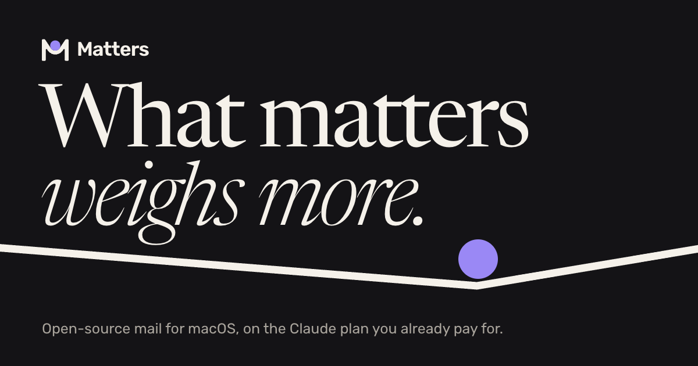

<div align="center">

<a href="https://getmatters.app">
  
</a>

# Matters

**The mailbox with your LLMs built in.**

An open-source desktop mail client that keeps your mail on your computer<br />
and shows you what is still on you: what you promised, who waits for an answer, what has a date.

[Website](https://getmatters.app) ·
[Download](https://getmatters.app/download.html) ·
[Architecture](docs/architecture.md) ·
[Decisions](docs/adr/README.md) ·
[Security](SECURITY.md)

[](https://github.com/milolabs/matters-app/actions/workflows/ci.yml)
[](https://github.com/milolabs/matters-app/actions/workflows/codeql.yml)
[](https://scorecard.dev/viewer/?uri=github.com/milolabs/matters-app)
[](LICENSE)
[](#build-and-run)

</div>

<a href="https://getmatters.app">
  
</a>

> [!NOTE]
> Matters is early. There is no download yet: today you build it from source, and it is developed
> and tested on macOS. [What it does not do yet](#what-it-does-not-do-yet) is listed below, and
> [docs/release.md](docs/release.md) says how the first release will be made.

## Contents

- [What it does](#what-it-does)
- [The agent runs on your own plan](#the-agent-runs-on-your-own-plan)
- [What it does not do yet](#what-it-does-not-do-yet)
- [Build and run](#build-and-run)
- [How it is built](#how-it-is-built)
- [Documentation](#documentation)
- [Contributing](#contributing)
- [Security](#security)
- [License](#license)

## What it does

- **Local first.** Mail is synced over IMAP into a SQLite database on your computer. The window
  reads only local data, so lists, search and threads do not wait for the network.
- **Fast by design.** Speed has budgets that are measured on mailboxes of 8,000, 100,000 and
  500,000 messages ([ADR 0012](docs/adr/0012-performance-budgets.md)).
- **Views with a prompt.** Write in your own words what you want to find, such as
  `prompt:"mail that needs my reply or decision"`, and save it as a tab. An agent reads the mail
  the rest of the query finds, shows what fits with a reason beside each row, and reads new mail
  for the view as it comes ([ADR 0116](docs/adr/0116-a-prompt-is-a-filter.md),
  [ADR 0117](docs/adr/0117-matters-is-a-view-with-a-prompt.md)). The first time you turn AI on, a
  view named `Needs you` is added, and you can change or delete it like any other.
- **Ask and draft.** Ask the agent about a thread or all your mail, and have it draft a reply for
  you to check and send.
- **Careful with hostile mail.** Remote content, tracking and active HTML are handled by rules
  that are tested against a corpus of made-up hostile messages
  ([ADR 0047](docs/adr/0047-hostile-mail-corpus.md),
  [security standards](docs/security/standards.md)).
- **Works without AI.** You choose, per account, whether the agent may read it.

## The agent runs on your own plan

Matters has no server of its own. The agent runs on what you already have
([ADR 0051](docs/adr/0051-agents-on-the-users-own-plans.md)):

| Runtime | Runs on | Good to know |
| --- | --- | --- |
| [Claude Code](https://claude.com/claude-code) | The Claude plan you already pay for | Runs through Claude Code on your computer |
| Codex | Your ChatGPT plan | Each turn runs with its own tools off ([ADR 0120](docs/adr/0120-codex-is-a-runtime.md)) |
| [Ollama](https://ollama.com) | A model on your computer | Mail never leaves it ([ADR 0119](docs/adr/0119-a-runtime-on-this-machine.md)) |

## What it does not do yet

- **Sign-in is by password only.** Gmail, iCloud, Yahoo and Fastmail work with an app password.
  Microsoft 365 and Outlook.com need browser sign-in (OAuth), which is not built yet, so they do
  not work.
- **The agent connects to Claude Code, Codex and Ollama only.** API keys are planned.
- **Codex does not report the plan's limits**, so reading in the background stops at the first
  refusal until you continue it.
- **With Ollama, attachments depend on the model.** One that takes tools searches in a loop and
  reads the text of attached files, one that sees images gets images whole, and a scan in a PDF is
  not sent whole.
- **No download, no updates, no Windows or Linux build.** How the first release will be made is in
  [docs/release.md](docs/release.md).

## Build and run

You need [Bun](https://bun.sh) 1.4 and macOS.

```sh
git clone https://github.com/milolabs/matters-app.git
cd matters-app
bun install
bun run dev:desktop:demo   # the app on a made-up mailbox
bun run dev:desktop        # the app on your own accounts
```

The checks to run before you push:

```sh
bun run typecheck          # types
bun run lint               # Biome
bun run test               # unit tests and the hostile-mail corpus
bun run check:boundaries   # the rules of the architecture
bun run check:licenses     # licenses of dependencies
bun run smoke:desktop      # builds the app and starts it
```

CI runs the first five and then packages the app; it does not start it.
[CONTRIBUTING.md](CONTRIBUTING.md#the-checks) has the details.

## How it is built

A hexagonal monorepo: the core knows nothing of IMAP, SQLite or Electron, and everything else
plugs into its ports.

| Path | What is there |
| --- | --- |
| [`packages/core`](packages/core) | The domain and the use cases |
| [`packages/contracts`](packages/contracts) | The types the processes share |
| [`packages/adapter-*`](packages) | Adapters for the ports: IMAP, SMTP, SQLite, MIME, secrets, Claude Code, Codex, Ollama and more |
| [`apps/desktop`](apps/desktop) | The Electron app with a Solid renderer |
| [`site`](site) | [getmatters.app](https://getmatters.app): plain HTML and CSS with no build step, published with GitHub Pages ([ADR 0127](docs/adr/0127-the-site-lives-in-the-repository.md)) |
| [`tools`](tools) | The checks, smoke tests, benchmarks and release scripts |
| [`docs`](docs) | Architecture, decisions, security, brand and release |

To see the site, serve the folder, for example with
`python3 -m http.server --directory site`.

## Documentation

| Page | What it answers |
| --- | --- |
| [docs/architecture.md](docs/architecture.md) | The map: what the parts are and how they talk |
| [docs/adr](docs/adr/README.md) | Every decision and its reasons, one record each |
| [docs/security/threat-model.md](docs/security/threat-model.md) | What the app is meant to withstand |
| [docs/security/standards.md](docs/security/standards.md) | The rules the code is held to |
| [docs/release.md](docs/release.md) | How a version gets from `main` to a download |
| [docs/brand](docs/brand/README.md) | The mark, its construction and its files |

## Contributing

Issues and pull requests are welcome. [CONTRIBUTING.md](CONTRIBUTING.md) says how to set up, what
the checks are and how a change reaches `main`. In short:

- Contributors are asked to sign a contributor license agreement that grants a license to the
  project and leaves the copyright with them
  ([ADR 0002](docs/adr/0002-license-agpl-and-cla.md)). The agreement is not set up yet; until it
  is, please open an issue before starting on a larger change.
- Every change reaches `main` through a pull request. The checks run on it, and an automatic
  reviewer reads it first ([ADR 0126](docs/adr/0126-changes-reach-main-by-pull-request.md)).

## Security

Please report security problems privately, not in a public issue: [SECURITY.md](SECURITY.md) says
how, and what the app is meant to withstand.

## License

[GNU Affero General Public License, version 3 only](LICENSE) (`AGPL-3.0-only`). The name Matters
and its logo are not covered by the license.
